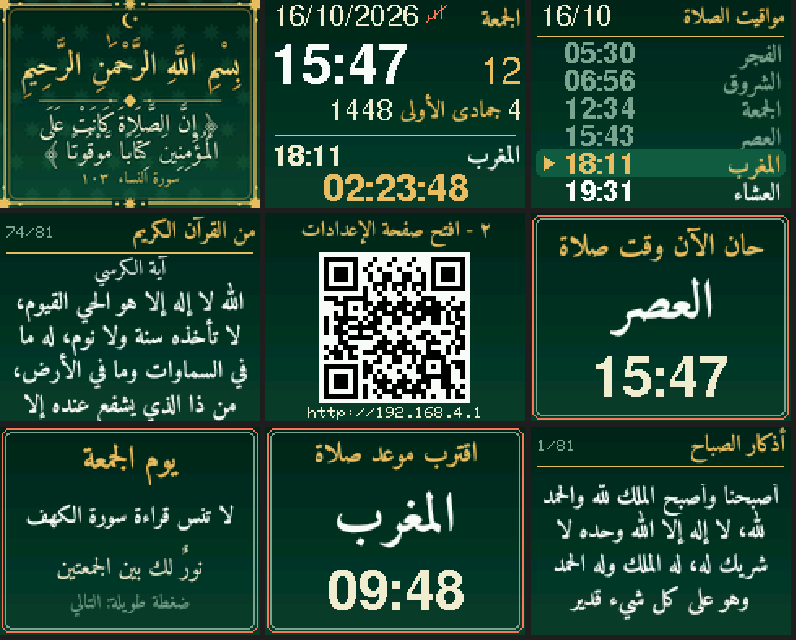
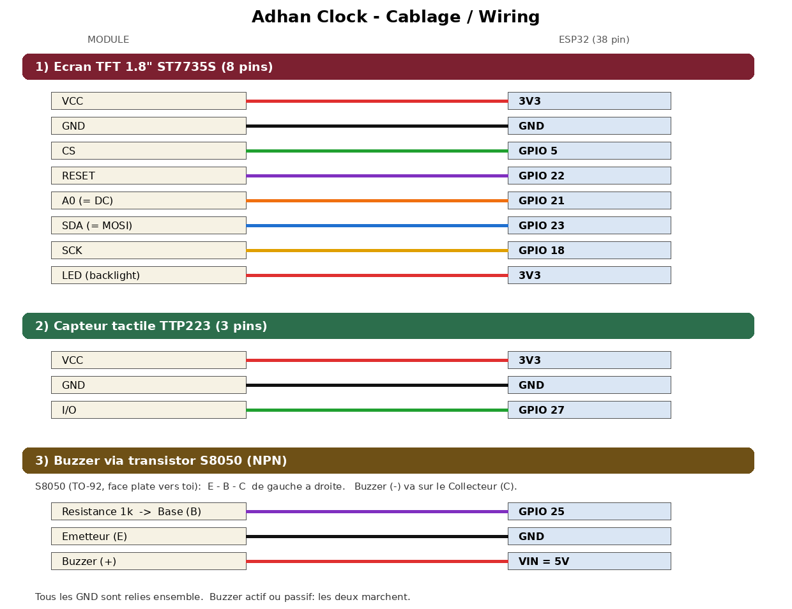
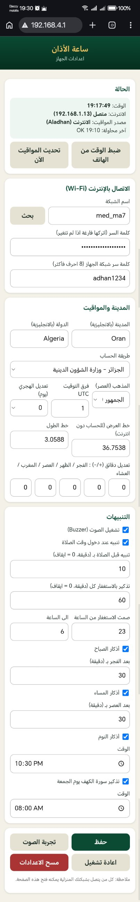

# 🕌 Adhan Clock — ساعة الأذان (ESP32)

  

An open-source **Islamic desk clock** built with an **ESP32**, a **1.8" ST7735S TFT**, a **TTP223 touch sensor** and a **buzzer**.
Created by **El-Amine ([@MedMA07](https://github.com/MedMA07))** — Oran, Algeria 🇩🇿.

> If you use, modify or share this project, please keep the credit to the original author (see [LICENSE](LICENSE)). Contributions and improvements are welcome ❤️


*(PC simulation of the screens — the real display is 160×128)*

## ✨ Features
- Clock + Gregorian date + **Hijri date**, big countdown to the **next prayer**
- **Prayer times** for your city (Aladhan API, cached; offline fallback calculation)
- **Adhkar & du'as** slideshow (60+ pages: morning, evening, after prayer, sleep, Qur'anic du'as, Ayat al-Kursi, Mu'awwidhat…)
- Reminders: adhan alert, pre-adhan alert, morning/evening/sleep adhkar, **Surat al-Kahf on Friday**, hourly istighfar
- **One touch sensor** switches screens (tap / hold)
- **Phone link by QR code**: scan → join the clock's Wi-Fi → open the settings page (Wi-Fi, city, method, alerts, times…)
- Splash screen: *بسم الله الرحمن الرحيم* + *إن الصلاة كانت على المؤمنين كتابا موقوتا*
- Arabic text rendered as pre-generated, **compressed anti-aliased bitmaps** (Amiri font) — no Arabic font engine needed on the ESP32

## 🧰 Hardware
ESP32 38-pin devkit · TFT 1.8" 128×160 ST7735S · TTP223 touch module · buzzer · S8050 NPN + 1 kΩ (optional driver) · jumper wires.

### Wiring


| Module | ESP32 |
|---|---|
| TFT VCC / LED | 3V3 |
| TFT GND | GND |
| TFT CS | GPIO 5 |
| TFT RESET | GPIO 22 |
| TFT A0 (DC) | GPIO 21 |
| TFT SDA (MOSI) | GPIO 23 |
| TFT SCK | GPIO 18 |
| TTP223 VCC / GND / I/O | 3V3 / GND / GPIO 27 |
| Buzzer (+) | VIN (5V) |
| Buzzer (−) | S8050 collector |
| S8050 base | 1 kΩ → GPIO 25 |
| S8050 emitter | GND |

S8050 (TO-92, flat face towards you): **E – B – C** from left to right. Simple alternative for a small buzzer: (+) → GPIO 25, (−) → GND.

## 🚀 Install
1. Arduino IDE → Boards Manager → **esp32 by Espressif**, version **2.0.17** (stable).
2. Library Manager → install: `Adafruit GFX Library`, `Adafruit BusIO`, `Adafruit ST7735 and ST7789 Library`, `ArduinoJson` (**7.x**). *(The QR generator is bundled.)*
3. Open `AdhanClock/AdhanClock.ino` (keep all files of the folder together).
4. Board **ESP32 Dev Module**, Partition Scheme **Huge APP (3MB No OTA/1MB SPIFFS)** (recommended), then **Upload**.

## 👆 Controls
| Touch | Action |
|---|---|
| Tap | next screen (Home → Prayer times → Adhkar → QR) |
| Hold ≈1 s | next page (adhkar) · switch QR · confirm "Kahf read" (Home, Friday) |
| Hold ≈2 s | next adhkar category |
| Hold 6 s on QR screen | factory reset |
| Any touch during the adhan | silence + show the after-adhan du'a |

## 📱 First use
1. After the splash, tap until screen **4** (QR).
2. QR #1 → join Wi-Fi `AdhanClock` (password `adhan1234`). QR #2 → opens `http://192.168.4.1`.
3. In the page: scan Wi-Fi → password → city & country in English (e.g. `Algiers` / `Algeria`) → **Save**.
<p align="center"><br><sub>The settings page as seen on a phone (Arabic, RTL)</sub></p>

4. Defaults: Algeria, method 19, UTC+1. Morocco: method 21. No internet? Times are calculated locally and you can set the clock from your phone.

## 🔧 Display options (`AdhanClock/config.h`)
Picture shifted/colored edge → `TAB_TYPE` (`INITR_GREENTAB`/`INITR_REDTAB`) · inverted colors → `TFT_INVERT 1` · red/blue swapped → `SWAP_RB 1` · upside down → `ROTATION 3` · noise → lower `SPI_HZ` · touch inverted → `TOUCH_ACTIVE_HIGH 0`.

## 🛠️ Edit the adhkar / Arabic texts
Arabic is stored as bitmaps. Edit `AdhanClock/tools/gen_assets.py` (`DUAS`, `LABELS`, `CATS`), then:
```
pip install pillow          # needs RAQM support
cd AdhanClock/tools && python3 gen_assets.py
```
This regenerates `assets_*.h`; upload again.

## ❓ Troubleshooting
| Problem | Fix |
|---|---|
| `'DayData' has not been declared` | keep `types.h` next to the `.ino` |
| `esptool: unrecognized arguments` | use esp32 core **2.0.17**, not an alpha/other build |
| hundreds of `undefined reference to millis/delay…` | clear `%TEMP%\arduino_cache_*` and `arduino_build_*`, rebuild and let it finish |
| Sketch too big | choose **Huge APP** partition scheme |
| Cloud Editor `esptool not found` | update the Arduino Create Agent, or flash the `.bin` files with [esptool-js](https://espressif.github.io/esptool-js/) |

---

## 🇩🇿 دليل مختصر (Darija)
مشروع ساعة أذان كاملة: وقت + تاريخ ميلادي وهجري + مواقيت الصلاة + أذكار وأدعية + تذكير سورة الكهف يوم الجمعة، وتتحكم فيها بحساس لمس واحد وتربطها بالهاتف عبر QR. التوصيل والتثبيت فوق. أي مشكل افتح **Issue**.

## 📄 License & credits
[MIT](LICENSE) © 2026 **El-Amine (MedMA07)**. Third-party components (QR generator, Amiri font, Adafruit/ArduinoJson libraries, Aladhan API): see [THIRD_PARTY_NOTICES.md](THIRD_PARTY_NOTICES.md).

---

## ☕ Support My Work

---

### 🌐 Connect with Me (El-Amine):

<p>
<a href="https://www.linkedin.com/in/medma7/"></a>
<a href="https://github.com/MedMA07"></a>
<a href="https://linktr.ee/el.amine.m"></a>
<a href="https://www.instagram.com/medma_7/"></a>
<a href="https://t.me/med_ma7"></a>
<a href="https://api.whatsapp.com/send/?phone=213668598710"></a>
<a href="https://www.facebook.com/medma07"></a>
<a href="https://www.snapchat.com/add/med_ma7"></a>
</p>

📧 **Email:** elaminemed.ad@gmail.com <br>
📱 **Phone/WhatsApp:** +213 668 59 87 10 <br>
📍 **Location:** Oran, Algeria


<div align="center">

Made with ❤️ by El-Amine

</div>
